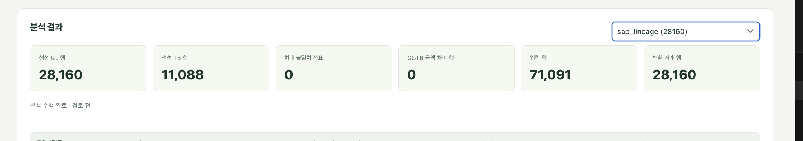
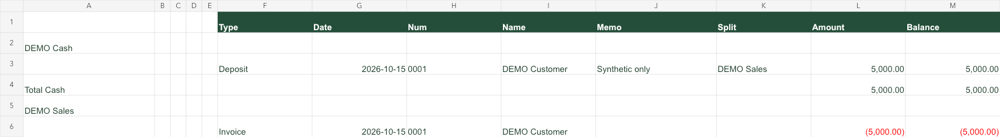
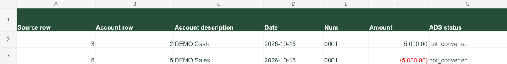
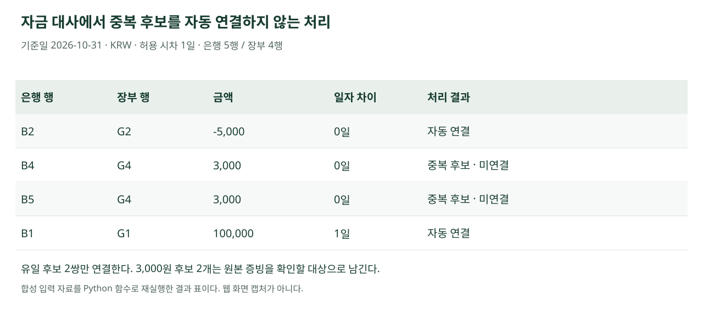
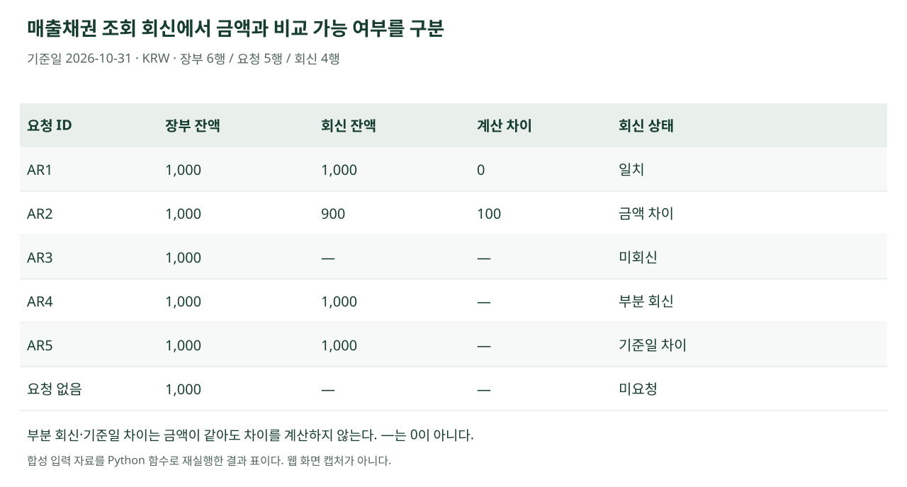

# Audit Platform

**회계 원본 자료를 분석 가능한 구조로 변환하고, 감사 검토 대상을 원본 행까지 연결하는 Python 웹 프로젝트이다.**

AICPA ADS 영문 명세의 GL 관련 4개 데이터셋 69개 필드를 학습하고, 공개 Python 예제와 딜로이트의 감사 분석 도구 소개를 참고하여 구성하였다. Python 분석 함수를 FastAPI와 HTML·CSS·JavaScript 화면에 연결하였다.

**[대표 결과 보기](#results) · [핵심 코드 확인](#code-map) · [직접 실행하기](#run) · [참고 자료와 기여 범위](#sources)**

웹 데모는 배포 전이며, 시연 영상은 제작 전이다. 현재는 아래 실행 방법과 공개용 합성 입력 자료로 확인할 수 있다.



*사용자가 실행한 SAP 학습 예제의 결과 화면이다. 선택 범위에서 GL 28,160행·TB 1,088행을 생성하였다. 차대 불일치·GL–TB 금액 차이가 0이라는 결과는 해당 입력 자료 간 정합성을 뜻한다.*

| 확인할 내용 | 바로 볼 수 있는 근거 |
|---|---|
| SAP 원본이 GL·TB로 바뀌는 과정 | [convert_sap_data](src/audit_data_lab/sap.py#L8-L132) · [노트북과 공통 함수 결과 비교 테스트](tests/test_sap_web.py#L16-L26) |
| 중복 금액을 임의로 연결하지 않는 처리 | [상호 유일 후보만 연결](src/audit_data_lab/cash.py#L99-L115) · [실행 결과 CSV](docs/portfolio/evidence/cash_candidate_links.csv) |
| 금액이 같아도 부분 회신·기준일 차이를 남기는 처리 | [회신 상태·차이 계산](src/audit_data_lab/confirmations.py#L19-L87) · [실행 결과 CSV](docs/portfolio/evidence/ar_confirmation_comparison.csv) |
| 브라우저 조작이 Python 실행으로 이어지는 경로 | [입력·실행 화면](frontend/workspace.js#L59-L94) → [작업 API](backend/app/job_routes.py) → [기능별 Python 호출](backend/app/analysis_dispatch.py) |
| 결과에서 입력 자료로 돌아가는 근거 | [원본 추적 구현](src/audit_data_lab/traceability.py) · [회신의 장부·요청·회신 연결 테스트](tests/test_confirmations.py#L81-L104) |

<a id="results"></a>
## 대표 실행 결과

### SAP 전처리

BSEG 전표 상세와 BKPF 전표 헤더를 결합하여 GL을 생성하고, GLT0 계정 잔액을 TB로 변환한다. 전표 차대 일치와 계정·기간별 GL 순변동 및 TB 변동을 확인한다.

| 입력 범위 | 생성 결과 | 검토 결과 |
|---|---|---|
| 회사 3000 · 2007년 · 원장 0 · 실적구분 0 · 버전 1 | GL 28,160행 · TB 1,088행 | 차대 불일치 0 · GL–TB 금액 차이 0 |

위 수치는 SAP 학습 예제 실행 결과이다. 추출 완전성·회계처리의 적정성이나 전체 ADS 준수를 입증한 수치는 아니다. 생성 GL·TB는 다운로드 후 후속 분석에 다시 업로드한다.

**구현 확인:** [convert_sap_data](src/audit_data_lab/sap.py#L8-L132) · [웹 호출부](backend/app/analysis_dispatch.py#L33-L34) · [입력·실행·원본 추적·ZIP 테스트](tests/test_sap_web.py#L32-L61)

### QuickBooks 보고서를 거래 표로 변환

계정 제목·빈 행·합계가 섞인 보고서에서 거래 행을 구분하고, 각 거래에 계정 제목과 원본 행 번호를 연결한다. 합성 보고서 6행에서 거래 2행을 추출하였다.

**변환 전**



**변환 후**



*합성 예제의 입력·결과 표이다. 원본 행 3·6을 계정 제목 행 2·5와 연결하였다. 이 단계는 보고서 평탄화이며 ADS GL 변환은 아니다.*

**직접 확인:** [입력 XLSX](data/demo/v1/quickbooks_report.xlsx) · [reshape_quickbooks_report](src/audit_data_lab/quickbooks.py#L12-L92) · [웹 호출부](backend/app/analysis_dispatch.py#L37-L41) · [검증 코드](tests/test_quickbooks.py)

### 자금 대사에서 중복 후보를 남기는 이유

계좌·통화·부호를 포함한 금액·일자 조건으로 후보를 찾는다. 은행과 장부 양쪽에서 후보가 하나인 경우에만 자동 연결한다. 같은 금액의 은행 거래 2개가 장부 거래 1개와 연결될 수 있으면 검토 대상으로 남긴다.



기준일 2026-10-31, 허용 시차 1일, 장기 미대사 기준 30일로 재실행한 결과이다. 100,000원 거래는 하루 시차를 두고 연결되며, 3,000원 중복 후보는 자동 연결하지 않는다. 이 일수는 시연 조건이다.

**직접 확인:** [은행 자료](data/demo/v1/bank.csv) · [장부 자료](data/demo/v1/cash_gl.csv) · [상호 유일 후보만 연결](src/audit_data_lab/cash.py#L99-L115) · [중복 후보 테스트](tests/test_deeper_analytics.py#L37-L42) · [결과 CSV](docs/portfolio/evidence/cash_candidate_links.csv)

### 조회 회신은 금액 일치만으로 끝내지 않는다

장부·요청·회신 정리표를 연결하고 단위·대상·통화·기준일을 대조한다. 같은 범위의 전액 확인 회신에만 장부와 회신의 차이를 계산한다.



부분 회신과 기준일 차이의 금액이 장부와 같아도 차이를 0으로 표시하지 않는다. 금융기관 회신에서는 금리·만기·담보 등 조건도 별도로 비교한다. 조회서 발송·회수 통제·진위 확인과 감사 결론은 구현 범위에 포함하지 않는다.

**직접 확인:** [합성 입력 6개 파일](data/demo/confirmations/) · [회신 상태·차이 계산](src/audit_data_lab/confirmations.py#L19-L87) · [부분·기준일 차이 테스트](tests/test_confirmations.py#L20-L26) · [잔액 일치 후 담보 차이 테스트](tests/test_confirmations.py#L75-L79) · [결과 CSV](docs/portfolio/evidence/ar_confirmation_comparison.csv)

<a id="code-map"></a>
## 기능과 코드 바로가기

| 브라우저 기능 | Python 처리 | 입력 자료·검증 근거 |
|---|---|---|
| SAP 전처리 | [convert_sap_data](src/audit_data_lab/sap.py#L8-L132) | [웹 실행·노트북 결과 비교](tests/test_sap_web.py) |
| QuickBooks 전처리 | [reshape_quickbooks_report](src/audit_data_lab/quickbooks.py#L12-L92) | [합성 입력](data/demo/v1/quickbooks_report.xlsx) · [테스트](tests/test_quickbooks.py) |
| 입력 사용자별 GL 분할 | [split_gl_by_user](src/audit_data_lab/gl_split.py#L6-L41) | [합성 GL](data/demo/v1/gl_jet.csv) · [테스트](tests/test_gl_user_split.py) |
| 데이터 클렌징 | [profile_data](src/audit_data_lab/cleansing.py#L7-L37) · [열 매핑](src/audit_data_lab/column_mapping.py) | [합성 입력](data/demo/v1/cleansing_raw.csv) · [입력 검증](tests/test_validation_errors.py) |
| 총계정원장 테스트 | [run_jet](src/audit_data_lab/jet.py#L44-L174) | [합성 GL](data/demo/v1/gl_jet.csv) · [로그 대사 기준 테스트](tests/test_log_basis.py) |
| 분석적 검토 | [analytical_review](src/audit_data_lab/analytics.py#L9-L36) | [전기·당기 GL](data/demo/v1/gl_comparison.csv) · [비율·비교 기준 테스트](tests/test_deeper_analytics.py) |
| 자금 대사 | [cash_proofing](src/audit_data_lab/cash.py#L9-L43) | [은행 자료](data/demo/v1/bank.csv) · [후보·조정 근거 테스트](tests/test_deeper_analytics.py) |
| 재고 분석 | [inventory_analysis](src/audit_data_lab/inventory.py#L8-L94) | [입출고 자료](data/demo/v1/movements.csv) · [기간 중 음수·로트 테스트](tests/test_deeper_analytics.py) |
| 매출채권 조회 회신 | [ar_confirmation_review](src/audit_data_lab/confirmations.py#L90-L91) | [합성 자료](data/demo/confirmations/) · [테스트](tests/test_confirmations.py) |
| 금융기관 조회 회신 | [bank_confirmation_review](src/audit_data_lab/confirmations.py#L94-L95) | [합성 자료](data/demo/confirmations/) · [테스트](tests/test_confirmations.py) |
| KYC 공시 | [extract_review_passages](src/audit_data_lab/kyc_passages.py#L16-L48) · [OpenDART 연결](src/audit_data_lab/kyc_live.py) | [본문 위치·후보 추출 테스트](tests/test_kyc_passages.py) |

### 화면에서 분석 함수까지

`frontend/workspace.js` → `backend/app/job_routes.py` → `backend/app/worker.py` → `backend/app/analysis_dispatch.py` → `src/audit_data_lab/`

노트북과 웹에서 공통 Python 함수를 활용한다. 사용자는 조건 입력·자료 업로드 후 분석을 실행하고, 결과 행에서 원본 자료와 계산 조건을 확인한다. 검토 내용은 별도로 기록하며 분석 시점 ZIP과 최신 검토 이력을 구분하여 보관한다.

[프론트엔드](frontend/workspace.js) · [업로드 처리](backend/app/uploads.py) · [분석 분기](backend/app/analysis_dispatch.py) · [원본 연결](src/audit_data_lab/traceability.py) · [조서 출력](backend/app/reporting.py)

<a id="run"></a>
## 로컬 실행

Python 3.12 환경을 기준으로 확인하였다. 저장소 루트에서 실행한다.

```bash
python3.12 -m venv .venv
.venv/bin/python -m pip install -r requirements.txt
.venv/bin/python scripts/run_local.py
```

1. `http://127.0.0.1:8000`을 연다.
2. 실행기가 만든 `.runtime/reviewer.token`을 로컬 편집기로 열어 개발용 연결 칸에 입력한다.
3. 기능을 선택하고 작업을 만든 뒤 [합성 시연 자료](data/demo/v1/)를 업로드한다. 조회 회신은 [전용 자료](data/demo/confirmations/)를 사용한다.
4. 분석 결과에서 행을 선택해 원본을 확인하고 검토 기록·조서 ZIP을 확인한다.

[기능별 시연 입력 안내](submission/demo_input_guide.md)에는 기존 기능의 입력·예상 결과가 있으며, 조회 회신 입력과 판정 사례는 [테스트 코드](tests/test_confirmations.py)에 있다. 공시 수집에는 별도의 DART 키가 필요하다. AI 요약은 서버에서 기본 비활성화되어 있으며 실제 호출 성공은 확인하지 않았다.

### 검증과 결과 재생성

```bash
.venv/bin/python -m unittest discover -s tests -p 'test_*.py' -v
.venv/bin/python scripts/build_portfolio_evidence.py
```

첫 명령은 전체 검사를 실행하며 SAP 원본을 사용하는 일부 검사는 로컬 학습 자료가 별도로 필요하다. README의 자금·조회 회신 결과는 두 번째 명령으로 합성 입력에서 다시 생성할 수 있다. 입력·소스 해시와 실행 조건을 [실행 기록](docs/portfolio/evidence/run_manifest.json)에 남긴다. 위 그림은 화면 캡처가 아닌 CSV 실행 결과를 시각화한 표이다.

<a id="sources"></a>
## 학습 자료와 기여 범위

| 구분 | 내용 |
|---|---|
| 데이터 구조 학습 | AICPA ADS 영문 명세를 읽고 GL_Detail 31개·Chart_Of_Accounts 13개·Trial_Balance 19개·Source_Listing 6개 필드를 개인 데이터 사전으로 정리하였다. [학습과 적용 요약](docs/portfolio/ads-learning.md)에 연결 관계와 적용 사례를 정리하였다. |
| 참고 코드 | AICPA ADS 공개 Python 예제의 SAP·QuickBooks·사용자별 분할 흐름을 검토하였다. 참고한 저장소는 아래에 표시하였다. |
| 추가·확장 | 입력 검증·분석 함수 정리·웹 실행·원본 추적·검토 기록·조회 회신 비교를 추가하거나 확장하였다. |
| 개발 도구 | 생성형 AI의 코드 작성·수정 지원을 활용하였다. 처리 조건과 결과를 확인하며 오류·비교 불가·미실행 사례를 검증하였다. |
| 업무 이해 | Deloitte Omnia·Levvia·Finance Data Hub 공개 자료로 기능 구성을 살펴보았다. 내부 코드나 데이터베이스에 접근하지 않았다. |

- [AICPA & CIMA General Ledger Standard](https://www.aicpa-cima.com/resources/download/general-ledger-standard-audit-data-standards)
- [AICPA ADS Python Example](https://github.com/AICPA-AuditDataAnalytics2018/ADS---Python-Example-)
- [AICPA AuditData API 공개 저장소](https://github.com/AICPA-ADS/AuditData-API) · [공식 소개](https://www.aicpa-cima.com/resources/article/aicpa-audit-data-api-request-for-review)
- [Deloitte Audit innovation](https://www.deloitte.com/kr/ko/services/audit-assurance/services/audit-innovation.html) · [Finance Data Hub 공식 발표](https://www.deloitte.com/kr/ko/about/press-room/2025/press-2025-12-17.html)
- [OpenDART 개발가이드](https://opendart.fss.or.kr/guide/main.do)

## 현재 범위와 한계

분석 결과는 추가 확인이 필요한 검토 대상이며, 오류·부정이나 감사의견을 확정하지 않는다. SAP 학습 예제·합성 시연 자료·실제 공개 공시는 서로 구분한다. 전체 ADS 준수나 Audit Data API 적합성을 검증한 구현은 아니다.

- 웹은 개발용 토큰과 임시 작업 보관을 사용하는 로컬 MVP이다. 공개 서비스 운영 인증은 별도 과제이다.
- GL·TB 대사 차이가 0이어도 ERP 추출의 완전성·증빙의 적정성을 입증하지 않는다.
- JET 로그 금액 대사는 필요한 근거를 확보·승인하지 못하면 미실행으로 남긴다.
- 조회 회신은 확보된 정리표 비교이며 발송·진위 확인·미회신 대체절차를 수행하지 않는다.
- 계정과목·재무제표 항목 전체 연결, 사용자 상태 이력 검증, AI 실제 호출 검증은 후속 과제이다.

공개 주소가 생기면 [링크 관리 파일](docs/portfolio/links.json)에 웹 데모·GitHub·영상 주소와 제출 기준 커밋을 기록한다. 현재 코드 링크는 저장소 상대 경로이며, 제출 시 검증한 커밋의 영구 링크로 고정한다.
